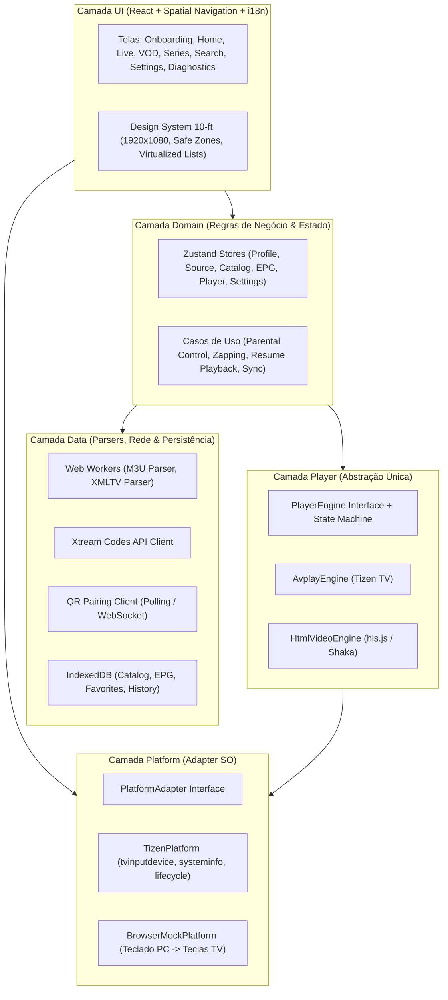

# Arquitetura do Sistema — NetTV

**Versão:** 1.0 (Fase 1)  
**Target mínimo:** Samsung Tizen 4.0 / Chromium M56 (TVs 2018+)

---

## 1. Stack Tecnológica Validada

| Camada | Tecnologia Escolhida | Justificativa & Adequação ao Alvo (Chrome 56+) |
|---|---|---|
| **Linguagem** | TypeScript (`strict: true`) | Segurança de tipos em parsers, estado e contratos da camada `platform/`. |
| **Build & UI** | React 18 + Vite + `@vitejs/plugin-legacy` | `@vitejs/plugin-legacy` gera bundle compatível com `chrome >= 56` (ES5/SystemJS fallback + polyfills necessários), mantendo DX rápida no dev server. |
| **Navegação por Foco** | `norigin-spatial-navigation` (com wrapper próprio de histórico de foco) | Leve, declarativa para React, suporta grupos/modais (focus trap) e memória do último foco. |
| **Estado** | Zustand | Mínimo boilerplate, zero Context hell, excelente performance com seletores granulares. |
| **Persistência** | IndexedDB (`idb` wrapper leve) + `localStorage` | IndexedDB armazena catálogos grandes (50k+ itens) e grade EPG indexada; `localStorage` guarda preferências leves (idioma, tema, perfil ativo). |
| **Processamento** | Web Workers nativos | Parsing de M3U/M3U8 e XMLTV fora da thread principal para evitar travamento da UI na TV. |
| **Player** | `AvplayEngine` (Tizen) + `HtmlVideoEngine` (`hls.js` / Shaka fallback) | `AVPlay` é nativo da TV (suporta MPEG-TS direto, HEVC, AC3); `hls.js`/Shaka permite desenvolver/testar no navegador e atuar como fallback. |
| **i18n** | `i18next` + `react-i18next` | Suporte nativo a `pt-BR` (padrão), `en` e `es`. |
| **Qualidade & CI** | ESLint, Prettier, Vitest, Playwright, GitHub Actions | Testes unitários de parsers/domínio, e2e simulando controle remoto no browser, build `.wgt` automatizado. |

---

## 2. Arquitetura em Camadas



### Responsabilidades por Pasta (`src/`)
- `src/platform/`: interface `PlatformAdapter` + implementações `TizenPlatform` (chama `tizen.*` e `webapis.*` com guards) e `BrowserMockPlatform` (mapeia setas, Enter, Backspace/Esc, teclas numéricas e de mídia no navegador).
- `src/player/`: interface `PlayerEngine`, máquina de estados (`idle`, `loading`, `buffering`, `playing`, `paused`, `error`), retry com backoff exponencial, `AvplayEngine` e `HtmlVideoEngine`.
- `src/data/`: clientes HTTP (fetch/XHR com timeout), Web Workers (`m3u.worker.ts`, `xmltv.worker.ts`), cliente Xtream Codes, cliente de pareamento QR e repositórios IndexedDB.
- `src/domain/`: tipos de domínio, stores Zustand, lógica de controle parental (PIN), histórico, favoritos e sincronização stale-while-revalidate.
- `src/ui/`: tokens de design, componentes 10-ft, gerenciador de foco/modais e telas.

---

## 3. Proposta de Backend Mínimo Efêmero — Pareamento via QR Code

Para atender ao requisito **RF-03** sem violar a premissa de "sem backend pesado/persistente":

### Fluxo Proposto
1. Na TV (tela de adicionar fonte), o app solicita à API efêmera `POST /pair/session` e recebe `{ sessionId, shortCode (6 chars), expiresAt (5 min) }`.
2. A TV exibe um **QR Code** apontando para `https://<dominio-pairing>/p?c=<shortCode>` e inicia polling leve (`GET /pair/session/:id` a cada 3s) ou WebSocket.
3. O usuário escaneia o QR Code no celular, preenche tipo de fonte (M3U ou Xtream), URL, usuário/senha e clica em **Enviar para TV**.
4. O formulário web envia via HTTPS `POST /pair/session/:id/payload`. O backend armazena o payload **apenas em memória/KV com TTL de 300 segundos** e o **apaga imediatamente** assim que a TV faz o `GET` de consumo (one-time read).
5. **Segurança & Privacidade (LGPD):** Nenhum dado de playlist ou credencial é gravado em banco de dados ou logs do servidor. Pode ser hospedado gratuitamente/baixo custo em Cloudflare Workers + KV (ou Vercel Edge + Upstash Redis). O código do micro-serviço ficará em pasta separada (ex.: `pairing-service/`), totalmente desacoplado do `.wgt`.

---

## 4. Modelo de Dados (Domínio & IndexedDB)

```typescript
export type SourceType = 'm3u' | 'xtream';

export interface Source {
  id: string;
  name: string;
  type: SourceType;
  url: string; // URL M3U ou base URL Xtream
  username?: string;
  password?: string; // armazenada apenas localmente
  epgUrl?: string;
  cacheTtlMinutes: number; // padrão ex: 720 (12h)
  lastSyncedAt?: number;
  createdAt: number;
}

export interface Profile {
  id: string;
  name: string;
  avatarId: string;
  pinHash?: string; // SHA-256 local do PIN parental (opcional)
  lockedCategoryIds: string[];
  lockedChannelIds: string[];
  createdAt: number;
}

export type ContentKind = 'live' | 'vod' | 'series';

export interface Category {
  id: string; // `${sourceId}:${kind}:${rawId}`
  sourceId: string;
  kind: ContentKind;
  name: string;
  order: number;
}

export interface Channel {
  id: string;
  sourceId: string;
  categoryId: string;
  number?: number;
  name: string;
  logoUrl?: string;
  streamUrl: string;
  epgChannelId?: string; // tvg-id
  isAdult?: boolean;
}

export interface VodItem {
  id: string;
  sourceId: string;
  categoryId: string;
  title: string;
  posterUrl?: string;
  backdropUrl?: string;
  synopsis?: string;
  year?: number;
  rating?: string;
  durationSec?: number;
  streamUrl: string;
  containerExtension?: string;
}

export interface Series {
  id: string;
  sourceId: string;
  categoryId: string;
  title: string;
  posterUrl?: string;
  backdropUrl?: string;
  synopsis?: string;
  year?: number;
  rating?: string;
  seasons: Season[];
}

export interface Season {
  seasonNumber: number;
  name: string;
  episodes: Episode[];
}

export interface Episode {
  id: string;
  seriesId: string;
  seasonNumber: number;
  episodeNumber: number;
  title: string;
  durationSec?: number;
  streamUrl: string;
  containerExtension?: string;
}

export interface EpgProgram {
  id: string;
  sourceId: string;
  channelEpgId: string; // correlação com Channel.epgChannelId
  title: string;
  description?: string;
  startMs: number;
  endMs: number;
}

export interface FavoriteItem {
  profileId: string;
  itemId: string;
  kind: ContentKind;
  addedAt: number;
}

export interface HistoryItem {
  profileId: string;
  itemId: string;
  kind: ContentKind;
  positionSec: number;
  durationSec: number;
  watched: boolean;
  updatedAt: number;
}
```

### Índices Principais no IndexedDB
- `categories`: `by_source_kind` (`[sourceId, kind]`)
- `channels`: `by_source`, `by_category`, `by_epg_id`, `by_name`
- `vod`: `by_source`, `by_category`, `by_name`
- `series`: `by_source`, `by_category`, `by_name`
- `epg`: `by_channel_time` (`[channelEpgId, startMs]`) — janela configurável (ex.: hoje + 2 dias) para manter o banco enxuto.

---

## 5. Estratégia de Erros, Logs e Telemetria

### Classificação de Erros
1. **Rede / Fonte (`NetworkError`, `AuthError 401/403`, `TimeoutError`, `ParseError`):** exibem mensagem acionável ao usuário (ex.: verificar URL, credenciais expiradas, aviso de servidor HTTP sem HTTPS).
2. **Reprodução (`PlayerStreamError`, `CodecUnsupportedError`, `NetworkDropError`):** acionam retry com backoff exponencial (1s, 2s, 4s, máx. 3 tentativas) antes de exibir tela de erro com opção "Tentar novamente" ou "Alternar engine".
3. **Armazenamento (`QuotaExceededError`):** limpa cache de EPG antigo automaticamente e notifica o usuário se persistir.

### Logs Seguros (Sanitização Obrigatória)
- **Regra absoluta:** Nunca logar em `console` ou memória de diagnóstico URLs completas com usuário/senha, tokens ou parâmetros de query sensíveis.
- Todo logger passa por função `sanitizeUrl(url)` que mascara `username`, `password` e query strings (`https://host.com/***`).
- Buffer circular em memória (últimos 100 eventos sanitizados) disponível na tela de **Diagnóstico**.

### Telemetria (Opt-in)
- Desativada por padrão (`telemetryEnabled: false`).
- Quando ativada explicitamente pelo usuário nas Configurações, envia apenas eventos agregados e anônimos (versão do app, ano/versão Tizen, código de erro de player/parser sem URLs ou identificadores pessoais).

